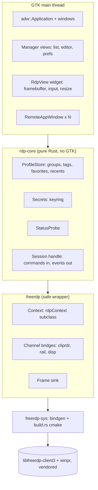

# Rust GTK4 RDP Client — Architecture Design

Status: draft for approval. Scope follows the requirements brainstorm. Move this file to the new repo's `docs/` when it exists.

## 1. Decisions carried in

| Area | Decision |
|---|---|
| Engine | FFI over libfreerdp-client3, vendored FreeRDP 3.33.0 as git submodule |
| UI | gtk-rs, GTK4 + libadwaita, Linux X11 and Wayland |
| Product | Connection manager first; session engine is a means |
| v1 features | Session, clipboard, audio playback, drives, printers, RDPGFX/H.264 (FreeRDP's FFmpeg), RAIL |
| Out | Mic, smartcard, Wake-on-LAN, Windows/macOS |
| Packaging | .deb, AppImage |
| Licence | MIT OR Apache-2.0 |

## 2. Layers



Rule: only `freerdp-sys` and `freerdp` contain `unsafe`. `rdp-core` and the app crate are `#![forbid(unsafe_code)]`. GTK types never cross into `rdp-core` or `freerdp`.

## 3. Repository layout

```
rdp-client/
  vendor/freerdp/            git submodule @ 3.33.0
  crates/
    freerdp-sys/             build.rs (cmake), bindgen allowlist
    freerdp/                 safe wrapper: Context, Session thread, channels
    rdp-core/                profiles, secrets, status probe, settings mapping
    app/                     GTK4/libadwaita binary
  data/                      .desktop, metainfo, icons, gschema
  packaging/                 deb/, appimage/
  THIRD-PARTY-LICENSES
```

## 4. Build (freerdp-sys)

`build.rs` runs CMake on `vendor/freerdp` with, at minimum:

- `WITH_CLIENT=OFF`, `WITH_CLIENT_COMMON=ON`, `WITH_SERVER=OFF`, `WITH_SHADOW=OFF`, `WITH_PROXY=OFF`, `WITH_SAMPLE=OFF`, `BUILD_TESTING=OFF`, `WITH_MANPAGES=OFF`
- `WITH_FFMPEG=ON` and `WITH_VIDEO_FFMPEG=ON` for H.264 (these option names exist in the root `CMakeLists.txt`)
- channels: cliprdr, rdpsnd (pulse and alsa subsystems), rdpdr (drive, printer via cups), rail, disp, rdpgfx
- shared libs (`BUILD_SHARED_LIBS=ON`) so the LGPL FFmpeg stays replaceable

Bindgen allowlist: `freerdp_.*`, `rdp(Context|Settings|Gdi|Update|Input)`, `Cliprdr.*`, `Rail.*`, `Disp.*`, `Rdpgfx.*`, `gdi_.*`, `FreeRDP_.*`, `PIXEL_FORMAT_.*`. Keep settings access generic through `freerdp_settings_get/set_*` with `FreeRDP_*` key IDs, so one mapping table drives per-profile overrides.

Cargo features: `vendored` (default) and `system` (pkg-config) reserved but not built in v1.

Environment note: GTK4/libadwaita dev packages are not installed on this machine (`pkg-config gtk4` fails); the dev setup doc must list them.

## 5. Threading model

FreeRDP is callback-driven and blocking. Decision: **one dedicated FreeRDP thread per session**, plus the GTK main thread. No tokio. Async on the UI side uses `glib::MainContext` and `gio`.

```mermaid
sequenceDiagram
  participant UI as GTK thread
  participant Q as cmd queue + wake handle
  participant FR as FreeRDP thread
  UI->>FR: spawn(Session::start(profile))
  FR->>FR: freerdp_connect, PreConnect, PostConnect
  FR-->>UI: Event::Connected
  loop event loop
    FR->>FR: wait(freerdp_get_event_handles + wake handle)
    FR->>FR: freerdp_check_event_handles
    FR-->>UI: Event::Frame(dirty rects) / Clipboard / Rail...
    UI->>Q: Command::Key / Mouse / Resize / Disconnect
    Q-->>FR: signals wake handle; thread drains queue
  end
  FR-->>UI: Event::Disconnected(reason)
```

- **UI → FreeRDP:** commands go through an `mpsc` queue; a WinPR event handle (`CreateEvent`) is added to the wait set to wake the loop. All `freerdp_input_send_*`, `freerdp_set_...`, display-control and channel sends happen on the FreeRDP thread. This avoids reasoning about which FreeRDP calls are thread-safe. (Confidence: moderate; other clients call input from the UI thread, but the queue is safer and costs microseconds.)
- **FreeRDP → UI:** events pushed through `async-channel`, received with `glib::spawn_future_local`. GTK is only touched on the main thread.
- **Blocking UI callbacks** (`AuthenticateEx`, `VerifyCertificateEx`, `LogonErrorInfo`): the FreeRDP thread sends an `Event::Prompt{kind, reply: oneshot}` and blocks on the reply. Mapping: `VerifyCertificateEx` returns `1` accept+store, `2` accept once, `0` reject (per `freerdp.h`).
- **Ownership:** `Session` owns the thread and joins it on drop after `freerdp_abort_connect_context`. The `rdpContext` never escapes the FreeRDP thread; the UI only holds the command sender and event receiver.

## 6. Context and callbacks (freerdp crate)

Use `RDP_CLIENT_ENTRY_POINTS` (`freerdp_client_context_new`, fields `ContextSize`, `ClientNew`, `ClientFree`, `ClientStart`, `ClientStop`, verified in `include/freerdp/client.h`). `ContextSize` = size of a `#[repr(C)]` struct whose first field is `rdpClientContext`, holding a `Box<SessionShared>` pointer. Callbacks are `extern "C"` trampolines that recover `SessionShared` from the context and forward to Rust closures. Panics in trampolines are caught (`catch_unwind`) and turned into `Event::Fatal`.

Callbacks installed: `PreConnect`, `PostConnect`, `PostDisconnect`, `AuthenticateEx`, `VerifyCertificateEx`, `VerifyChangedCertificateEx`, `LogonErrorInfo`, `update->BeginPaint/EndPaint/DesktopResize`, and PubSub `ChannelConnected`/`ChannelDisconnected` to attach channel contexts.

## 7. Framebuffer and GFX (single path)

- In `PostConnect`: `gdi_init(instance, PIXEL_FORMAT_BGRX32)`. For RDPGFX, `gdi_graphics_pipeline_init(gdi, gfx)` when `ChannelConnected` fires for `RDPGFX`. FreeRDP decodes (including H.264 through FFmpeg) into the GDI primary buffer, so **GFX and legacy bitmap updates share one output path**.
- `EndPaint`: read the invalid region from `gdi->primary->hdc->hwnd->invalid`, copy dirty rows into a back buffer owned by `FrameSink` (`Arc`, double buffered), emit `Event::Frame{rects, generation}`, reset the invalid region.
- UI: `RdpView` (custom `gtk::Widget`) builds a `gdk::MemoryTexture` (`B8g8r8x8`) from the latest buffer and draws it in `snapshot()`; scale factor handled with `gsk` transform. This is the CPU-copy path accepted for H.264. Budget: smooth at 1080p/60; 4K treated as best-effort and measured, not promised.
- Resize: `RdpView::size_allocate` debounced (150 ms) → `Command::Resize` → display-control channel (`disp`) → `gdi_resize` on `DesktopResize`.

## 8. Channel bridges

| Channel | Bridge |
|---|---|
| cliprdr | `CliprdrClientContext` callbacks ↔ `gdk::Clipboard`. Text (UTF-8/UTF-16) and PNG/DIB images. File transfer out of scope. Echo guard: ignore clipboard changes we caused (sequence counter). |
| rdpsnd | FreeRDP built-in subsystem (pulse, works over PipeWire's pulse shim). No custom Rust audio. Volume via profile only. |
| rdpdr | Drives from `DrivesToRedirect`/per-profile folder list (read-only flag honoured); printers via CUPS subsystem. Opt-in per profile; shown in status bar. |
| disp | Dynamic resize and monitor layout. |
| rail | `RailClientContext` + `update->window` callbacks: see §9. |

## 9. RAIL

- Server window create/update/delete callbacks become `Event::RailWindow{id, rect, title, state}`.
- One `RemoteAppWindow` (`adw::Window`) per remote window. It renders a **sub-rectangle of the shared primary buffer** (same `FrameSink`), cropped to the window's rect.
- Input in a RAIL window maps to desktop coordinates by adding the window origin.
- Move/resize/minimize/activate go back through `RailClientContext` (`ClientWindowMove`, `ClientActivate`, system commands).
- **X11:** positions the toplevel at the server position through `gdk_x11` surface APIs.
- **Wayland:** GTK4 has no way for a client to position toplevels. The compositor places windows, so remote positions are ignored and sizes are requested only. This is the documented best-effort behaviour.

## 10. rdp-core

**Data model**

```
Profile { id: Uuid, name, group_id: Option<Uuid>, tags: Vec<String>, favorite: bool,
          host, port, username, domain, gateway: Option<Gateway>,
          display: {mode, w, h, scale}, redirect: {clipboard, audio, printers, folders: Vec<{path, read_only}>},
          overrides: BTreeMap<String, Value>,   // raw FreeRDP settings by key name
          last_connected: Option<DateTime>, created, modified }
Group   { id, name, parent_id: Option<Uuid> }
```

- **Storage:** a single `profiles.json` under `$XDG_CONFIG_HOME/<app>/` (serde, atomic write via temp+rename). Reason: tens to hundreds of hosts; SQLite adds a dependency without need. Revisit if search needs exceed in-memory filtering.
- **Settings mapping:** `Profile → rdpSettings` is one function using the generic `freerdp_settings_set_*` API with `overrides` applied last (per-profile overrides requirement).
- **.rdp import/export:** `freerdp_client_settings_parse_connection_file` and `freerdp_client_settings_write_connection_file` (both in `client.h`); unknown keys kept in `overrides`.
- **Secrets:** Secret Service through the `oo7` crate (works with a keyring daemon and the Flatpak portal; no C `libsecret` dependency in the AppImage). Lookup key: profile UUID + username. Passwords never touch `profiles.json`, logs or `overrides`.
- **Search:** in-memory, substring over name, host, tags, group; sorted by recents/favorites.
- **StatusProbe:** `gio::SocketClient` async connect to host:port, 3 s timeout, every 60 s for visible rows only, paused when the window is not focused. Result is `Online(rtt_ms)`/`Offline`; no credentials involved.

## 11. App crate (GTK4 / libadwaita)

Windows map to the mockup boards: `ManagerWindow` (split view sidebar + list), `ProfileEditor` (`adw::PreferencesDialog`-style, 5 pages), `SessionWindow` (`adw::TabView` hosting `RdpView`), `RemoteAppWindow`, `CertDialog`, `CredentialsDialog`, `PreferencesDialog`. Single-instance (`gio::Application`), `.rdp` file association and `rdp://` handler. Actions/shortcuts via `gio::ActionMap` so keyboard use works without a pointer.

Input: GDK key events → X11 keycode / evdev → RDP scancode table (FreeRDP's `freerdp_keyboard_get_rdp_scancode_from_x11_keycode`); keyboard grab when focused full-screen. IME via `gtk::IMMulticontext` for Unicode input events.

## 12. Packaging

- **.deb:** depends on distro GTK4/libadwaita; bundles vendored `libfreerdp-client3`, `libwinpr3` in a private lib dir (`/usr/lib/<app>/`, rpath) so it does not conflict with the system FreeRDP. FFmpeg: depend on distro `libavcodec` (see licence note).
- **AppImage:** built on the oldest supported Ubuntu LTS; bundles GTK4, libadwaita, FFmpeg (LGPL-only, decoder-only configure with VAAPI), glib schemas and the pixbuf loaders. Portal-based file chooser for folder sharing.
- `THIRD-PARTY-LICENSES` generated with `cargo-about` plus a hand-kept native section.

## 13. Testing

1. **freerdp wrapper integration tests** against the tree's own `server/shadow` (built in CI only, `WITH_SHADOW=ON`) on a headless X server: connect, frame arrives, key/mouse round-trip, resize, clipboard round-trip.
2. **rdp-core unit tests:** profile CRUD, search, settings mapping, `.rdp` round-trip.
3. **UI smoke tests:** launch under `xvfb`/`weston --headless`, open manager and editor, no criticals in GLib log.
4. **Manual matrix:** Windows 10/11 and Server 2019/2022 (NLA, TLS, GFX/H.264, RAIL), Wayland and X11.

## 14. Risks and open items

| Risk | Impact | Mitigation |
|---|---|---|
| RAIL on Wayland | Windows placed by compositor | Documented, acceptance criteria say X11 full / Wayland best-effort |
| CPU copy for H.264 | 4K stutter | Measure early; fallback plan GStreamer/dmabuf, not in v1 |
| Callback/threading bugs | Crashes, deadlocks | Single FreeRDP thread per session; catch_unwind; fuzz the event queue |
| FFmpeg licence/patents | Release blocker | LGPL-only build, audit before first AppImage |
| Everything-in-v1 scope | Schedule | Build order below delivers a usable app early even though release waits |
| Vendored build time | Slow CI/dev loop | sccache, prebuilt `freerdp-sys` artifact cache |

Open items for you:
1. App id / name (needed for `.desktop`, gschema, keyring service name).
2. Minimum Ubuntu LTS to support (decides GTK/libadwaita floor: 22.04 ships GTK 4.6, libadwaita 1.1; 24.04 ships GTK 4.14, libadwaita 1.5).
3. Whether `rdp://` URL handler is wanted.

## 15. Suggested implementation order (internal, release stays all-in-v1)

1. `freerdp-sys` builds and links; hello-world `freerdp_new`.
2. `freerdp` wrapper: connect to shadow server, frames into a texture.
3. `rdp-core` store and settings mapping; manager UI over it.
4. Input, resize, auth/cert prompts.
5. Clipboard, audio, drives, printers.
6. GFX/H.264.
7. RAIL.
8. Packaging and licence audit.

Next step: `/sc:workflow` for a task breakdown, or `/sc:implement` starting with step 1.
